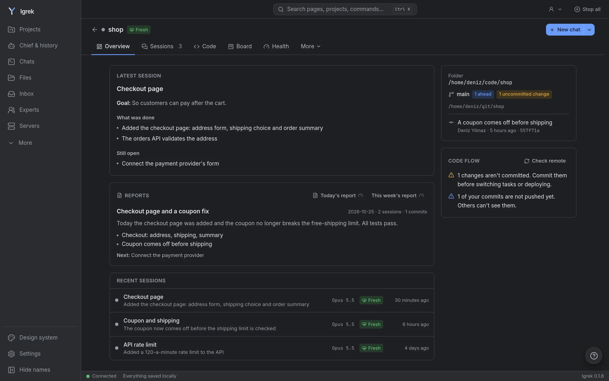

<p align="center"></p>

<h1 align="center">Igrek</h1>

<p align="center">
  One window for all your Claude Code and Codex work.<br>
  See what the AI changed and why, and keep your private details away from it.
</p>

<p align="center"><strong>Click to download:</strong></p>

<p align="center">
  <a href="https://github.com/Mohamedattiadev/igrek/releases/download/v0.1.22/Igrek_0.1.22_x64_en-US.msi"></a>
  <a href="https://github.com/Mohamedattiadev/igrek/releases/download/v0.1.22/Igrek_0.1.22_aarch64.dmg"></a>
  <a href="https://github.com/Mohamedattiadev/igrek/releases/download/v0.1.22/Igrek_0.1.22_x64.dmg"></a>
  <a href="https://github.com/Mohamedattiadev/igrek/releases/download/v0.1.22/Igrek_0.1.22_amd64.AppImage"></a>
  <a href="https://github.com/Mohamedattiadev/igrek/releases/download/v0.1.22/Igrek_0.1.22_amd64.deb"></a>
</p>

<p align="center">
  Free. No account. No API key.<br>
  <a href="https://mohamedattiadev.github.io/igrek/">Website</a> ·
  <a href="https://mohamedattiadev.github.io/igrek/docs/">Docs</a> ·
  <a href="README.tr.md">Türkçe</a>
</p>

<p align="center"></p>

## Get started in 3 steps

1. **Download** with a button above and open the file.
2. **Allow it** if your computer asks (see below). This happens once.
3. **Follow the app.** Pick your language and your project folders. If Claude Code or Codex is missing, Igrek offers
   to install it.

Mac and not sure which one? Open the Apple menu, then About This Mac. If it says M1, M2 or later, pick Apple silicon.
Otherwise pick Intel.

<details>
<summary><strong>Your computer says the app is not safe?</strong></summary>

Igrek does not have a paid signing certificate, so your system asks once.

- **Windows:** click **More info**, then **Run anyway**.
- **macOS:** close the message, open **System Settings > Privacy & Security**, scroll down, click **Open Anyway**.
- **Linux AppImage:** run `chmod +x Igrek_*.AppImage`, then open it. Some systems need `libfuse2` first.

</details>

## Prefer one command?

Paste one line into a terminal. It installs Igrek or updates it to the latest version.

**Linux and macOS**

```bash
curl -fsSL https://raw.githubusercontent.com/Mohamedattiadev/igrek/main/scripts/install.sh | sh
```

**Windows** (PowerShell, with [Git for Windows](https://git-scm.com/download/win) installed)

```powershell
irm https://raw.githubusercontent.com/Mohamedattiadev/igrek/main/scripts/install.ps1 | iex
```

Then type `igrek` and open http://localhost:7777. You also need [Claude Code](https://docs.claude.com/en/docs/claude-code).

## What it does for you

- **Shows why a file changed.** Each changed file has a Why? button that shows the message behind it.
- **Works across projects.** Type one task and Igrek sends it to the right project.
- **Checks your project.** Security, tests and more get a score, and simple problems have a Fix button.
- **Protects private details.** IBANs, card numbers and `.env` values are hidden before a message leaves your computer.
- **Lets you undo.** Each file the AI changed can be undone in one click.
- **Works for non-coders too.** Simple mode uses plain words, so you only type what you want.

Everything runs on your computer. There is no telemetry and no Igrek server. Igrek uses the Claude Code and Codex
logins you already have. Full list of features: [the docs](https://mohamedattiadev.github.io/igrek/docs/).

## Questions

**Where is my data?** On your computer, in `~/.igrek`.

**How do I update?** The app asks when a new version is out. If you used the command, run it again.

**How do I remove it?** Uninstall the app, then delete `~/.igrek` (your data) and `~/.local/share/igrek-runtime`
(Windows: `%LOCALAPPDATA%\igrek-runtime`).

**Need help?** See [SUPPORT.md](SUPPORT.md). Security problems: [SECURITY.md](SECURITY.md).

## License

Free to install and use, companies included. Igrek is not open source: see [LICENSE](LICENSE).

