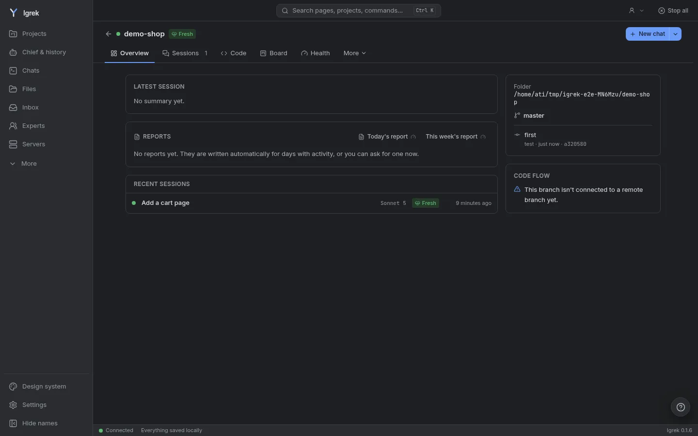

<p align="center"></p>

<h1 align="center">Igrek</h1>

<p align="center">
  A desktop app for Claude Code and Codex. It keeps the chats of all your projects in one window,<br>
  shows which request changed which file, and hides your secrets from the model.
</p>

<p align="center">
  <a href="https://mohamedattiadev.github.io/igrek/">Website</a> ·
  <a href="https://mohamedattiadev.github.io/igrek/docs/">Docs</a> ·
  <a href="https://github.com/Mohamedattiadev/igrek/releases/latest">Download</a> ·
  <a href="#türkçe">Türkçe</a>
</p>

<p align="center"></p>

## What it does

Claude Code and Codex write the code. Igrek runs next to them on your computer and keeps track of what they did.

- **Why did this file change?** Every changed file has a Why? button: the message that asked for it, the plan step
  it belongs to, and any expert asked in the same turn. It is read from the chat, not guessed.
- **One box for every project.** Type a task on the home page; Igrek sends it to the right project, or to several at
  once, each working in its own copy.
- **Health and Fix.** Architecture, security, tests, dependencies and more get a score. Simple findings have a Fix
  button that shows the command before it runs; the rest go to the right expert in a copy you review.
- **Secrets stay on your side.** Saved details (IBANs, ID and card numbers, salaries) and the values in your `.env`
  files become placeholders such as `[[private:iban]]` before a message leaves, and are put back in the answer.
- **About thirty experts.** Read-only reviewers from security and databases to product and finance. Call one with `@`
  in a chat. Each review is a model call, so none run unless you ask.
- **Notes per project.** Decisions and past mistakes are saved per project and given to the agent at the start of a
  chat. Rules that are only in `CLAUDE.md` or only in `AGENTS.md` are shown so both agents follow the same.
- **Accounts and limits.** Switch between your Claude and Codex accounts; each chat shows what a turn took of your
  5-hour limit and what is left.
- **More:** scheduled tasks, your servers (each step waits for your OK), a browser extension that fills forms
  without the AI seeing your details, a team hub you host yourself, and moving a chat or all of Igrek to another computer.

Everything runs on your computer. There is no account, no telemetry and no server of ours, and no API key is needed:
Igrek uses the Claude Code and Codex logins you already have. Settings lists every address it connects to.

## Install

### Desktop app (the easiest)

Download the package for your computer from the [latest release](https://github.com/Mohamedattiadev/igrek/releases/latest):
`.msi` for Windows, `.dmg` for macOS (Apple silicon: `aarch64`, Intel: `x64`), `.AppImage` or `.deb` for Linux.
Each is about 17 MB. On the first start the app downloads Bun, which runs Igrek's server (about 35 MB, checked against
Bun's published checksum), once. Claude Code and Codex are not in the package; Igrek offers to install them on the first start.

The packages are not signed with a paid certificate, so the system asks once:

- **Windows:** "Windows protected your PC": **More info > Run anyway**.
- **macOS:** "Igrek cannot be opened": close it, scroll down in **System Settings > Privacy & Security**,
  click **Open Anyway** next to Igrek, then **Open**.
- **Linux (AppImage):** `chmod +x Igrek_*.AppImage`, then open it (some systems need `libfuse2` first).

Closing the window stops Igrek and everything it started. The tray icon can hide the window, and `Ctrl+Space` from any
program opens a quick question. Details: [docs/desktop.md](docs/desktop.md).

### From a terminal, without Docker

Linux and macOS:

```bash
curl -fsSL https://raw.githubusercontent.com/Mohamedattiadev/igrek/main/scripts/install.sh | sh
```

Windows (PowerShell; install [Git for Windows](https://git-scm.com/download/win) first, Claude Code uses its bash):

```powershell
irm https://raw.githubusercontent.com/Mohamedattiadev/igrek/main/scripts/install.ps1 | iex
```

By hand: install [Bun](https://bun.sh) and Git, install Claude Code and run `claude` once to sign in, then:

```bash
git clone https://github.com/Mohamedattiadev/igrek.git && cd igrek
bun install
bun run build      # builds the interface
bun run start      # http://localhost:7777
bun run doctor     # checks the setup
```

Screenshots of your running app need Chrome, Chromium or Edge (set `IGREK_BROWSER` if yours is elsewhere).

### With Docker

```bash
git clone https://github.com/Mohamedattiadev/igrek.git && cd igrek
cp .env.example .env     # IGREK_PROJECTS_DIR=the folder that holds your projects (it must exist)
mkdir -p ~/.igrek
docker compose up -d
```

Then open http://localhost:7777. To put Claude Code or Codex in the image, set `IGREK_INSTALL_CLAUDE=true` and/or
`IGREK_INSTALL_CODEX=true` in `.env` and run `docker compose up -d --build` (Codex adds about 300 MB).

### First start

Pick your language, say whether you write code (Simple or Developer mode, changeable any time), and add your project
folders. Folders Claude has already worked in are listed, one click each.

## Update and remove

The desktop app looks for a new version when it opens and once a day, and installs it after you agree. A terminal
install updates by running the install command again; Docker with `git pull && docker compose up -d --build`.

To remove Igrek, uninstall the app (or delete the AppImage) and delete `~/.igrek` (your data) and
`~/.local/share/igrek-runtime` (Windows: `%LOCALAPPDATA%\igrek-runtime`).

## Use it with a team (optional)

A team runs a small hub on a server of its own:

```bash
docker compose -f docker/hub-compose.yml up -d --build
docker compose -f docker/hub-compose.yml exec hub igrek-hub create-admin <your-username>
```

Put Caddy in front for HTTPS (`docker/Caddyfile.example`). Then in Igrek: **Team > Sign in with username**. The first
sign-in shows a recovery key; keep it in a password manager. Each teammate you invite gets one invite code. The hub can
also email invite and password-reset codes through your own mail account: set `SMTP_HOST`, `SMTP_PORT`, `SMTP_USER`
and `SMTP_PASS` in `docker/hub.env`.

- Everything is encrypted on your computer before it goes to the hub; the hub cannot read it.
- Nothing is sent until you share a project, and secrets are removed first.
- AI accounts, SSH keys and `.env` files are never sent; everyone uses their own AI account.

## Questions

**Do I need to know how to code?** No. In Simple mode a project shows its overview, chats and files in plain words,
and you type what you want.

**Where is my data?** On your computer, in `~/.igrek`.

**Updating from God Eye?** On the first start Igrek moves `~/.godeye` to `~/.igrek` and leaves a link at the old path;
old `GODEYE_*` settings, hooks, plugins and the MCP entry keep working. With Docker: `docker compose down`, then once
`mv ~/.godeye ~/.igrek`, then `docker compose up -d --build`.

**Can I undo what the AI changed?** Yes. The files a chat changed are listed above the chat with a diff, and each can
be undone in one click.

The roadmap is in [plan.md](plan.md).

---

## Türkçe

Claude Code ve Codex için bir masaüstü uygulaması. Tüm projelerinin sohbetlerini tek pencerede toplar, hangi isteğin
hangi dosyayı değiştirdiğini gösterir ve sırlarını modelden saklar.
[Site](https://mohamedattiadev.github.io/igrek/tr/) · [Belgeler](https://mohamedattiadev.github.io/igrek/tr/docs/) ·
[İndir](https://github.com/Mohamedattiadev/igrek/releases/latest)

### Ne yapar

Kodu Claude Code ve Codex yazar. Igrek onların yanında, senin bilgisayarında çalışır ve ne yaptıklarını takip eder.

- **Bu dosya neden değişti?** Değişen her dosyanın bir Neden? düğmesi var: onu isteyen mesaj, ait olduğu plan adımı ve
  aynı turda sorulan uzman. Sohbetten okunur, tahmin edilmez.
- **Her proje için tek kutu.** Ana sayfaya bir iş yaz; Igrek onu doğru projeye ya da aynı anda birkaçına gönderir,
  her biri kendi kopyasında çalışır.
- **Sağlık ve Düzelt.** Mimari, güvenlik, testler, bağımlılıklar ve daha fazlası puanlanır. Basit bulgularda bir Düzelt
  düğmesi var, komutu çalıştırmadan önce gösterir; diğerlerini doğru uzman, senin bakacağın bir kopyada yapar.
- **Sırlar senin tarafında kalır.** Kayıtlı bilgiler (IBAN, kimlik ve kart numarası, maaş) ve `.env` dosyalarındaki
  değerler, mesaj çıkmadan `[[private:iban]]` gibi yer tutuculara dönüşür, cevapta geri konur.
- **Otuz kadar uzman.** Güvenlikten veritabanına, üründen finansa salt okunur inceleyiciler. Sohbette `@` ile birini
  çağır. Her inceleme bir model çağrısı olduğu için sen istemedikçe hiçbiri çalışmaz.
- **Proje başına notlar.** Kararlar ve geçmiş hatalar proje başına saklanır, sohbetin başında ajana verilir. Yalnızca
  `CLAUDE.md`'de ya da yalnızca `AGENTS.md`'de olan kurallar gösterilir, iki ajan da aynı kurallara uyar.
- **Hesaplar ve limitler.** Claude ve Codex hesapların arasında geçersin; her sohbet bir turun 5 saatlik limitinden ne
  kadar yediğini ve ne kaldığını gösterir.
- **Ayrıca:** zamanlanmış işler, sunucuların (her adım senin onayını bekler), özel bilgilerini AI görmeden form
  dolduran bir tarayıcı eklentisi, kendi kurduğun takım hub'ı, bir sohbeti ya da tüm Igrek'i başka bilgisayara taşıma.

Her şey senin bilgisayarında çalışır. Hesap yok, telemetri yok, bizim bir sunucumuz yok; API anahtarı da gerekmez:
Igrek zaten olan Claude Code ve Codex girişlerini kullanır. Bağlandığı her adres Ayarlar'da listelenir.

### Kurulum

**Masaüstü uygulaması (en kolayı).** Bilgisayarına uygun paketi [son sürümden](https://github.com/Mohamedattiadev/igrek/releases/latest)
indir: Windows için `.msi`, macOS için `.dmg` (Apple işlemci: `aarch64`, Intel: `x64`), Linux için `.AppImage` ya da `.deb`.
Her biri yaklaşık 17 MB. İlk açılışta uygulama, Igrek'in sunucusunu çalıştıran Bun'ı bir kez indirir (yaklaşık 35 MB,
Bun'ın yayımladığı sağlama değeriyle doğrulanır). Claude Code ve Codex pakette yok; Igrek ilk açılışta kurmayı önerir.

Paketler ücretli bir sertifikayla imzalı olmadığı için sistem bir kez sorar:

- **Windows:** "Windows bilgisayarınızı korudu": **Ek bilgi > Yine de çalıştır**.
- **macOS:** "Igrek açılamıyor": kapat, **Sistem Ayarları > Gizlilik ve Güvenlik**'te aşağı kaydır, Igrek'in yanındaki
  **Yine de Aç**'a, sonra **Aç**'a tıkla.
- **Linux (AppImage):** `chmod +x Igrek_*.AppImage`, sonra aç (bazı sistemlerde önce `libfuse2` gerekir).

Pencereyi kapatınca Igrek ve başlattığı her şey durur. Tepsi ikonuyla pencere gizlenebilir; herhangi bir programdayken
`Ctrl+Space` hızlı soru açar. Ayrıntılar: [docs/desktop.md](docs/desktop.md).

**Terminalden, Docker'sız.** Linux ve macOS:

```bash
curl -fsSL https://raw.githubusercontent.com/Mohamedattiadev/igrek/main/scripts/install.sh | sh
```

Windows (PowerShell; önce [Git for Windows](https://git-scm.com/download/win) kur, Claude Code onun bash'ini kullanır):

```powershell
irm https://raw.githubusercontent.com/Mohamedattiadev/igrek/main/scripts/install.ps1 | iex
```

Elle: [Bun](https://bun.sh) ve Git'i kur, Claude Code'u kurup bir kez `claude` yazarak giriş yap, sonra:

```bash
git clone https://github.com/Mohamedattiadev/igrek.git && cd igrek
bun install
bun run build      # arayüzü derler
bun run start      # http://localhost:7777
bun run doctor     # kurulumu kontrol eder
```

Çalışan uygulamanın ekran görüntüleri için Chrome, Chromium ya da Edge gerekir (başka yerdeyse `IGREK_BROWSER` ile yolunu ver).

**Docker ile.**

```bash
git clone https://github.com/Mohamedattiadev/igrek.git && cd igrek
cp .env.example .env     # IGREK_PROJECTS_DIR=projelerinin olduğu klasör (var olmalı)
mkdir -p ~/.igrek
docker compose up -d
```

Sonra http://localhost:7777 adresini aç. Claude Code ya da Codex'i imaja koymak için `.env`'de
`IGREK_INSTALL_CLAUDE=true` ve/veya `IGREK_INSTALL_CODEX=true` yap ve `docker compose up -d --build` çalıştır
(Codex yaklaşık 300 MB ekler).

**İlk açılış.** Dilini seç, kod yazıp yazmadığını söyle (Basit ya da Geliştirici mod, istediğin zaman değişir) ve proje
klasörlerini ekle. Claude'un daha önce çalıştığı klasörler listelenir, her biri tek tık.

### Güncelleme ve kaldırma

Masaüstü uygulaması açılırken ve günde bir kez yeni sürüme bakar, sen onaylayınca kurar. Terminalden kurduysan kurulum
komutunu yeniden çalıştır; Docker'da `git pull && docker compose up -d --build`.

Kaldırmak için uygulamayı kaldır (ya da AppImage'ı sil), `~/.igrek` (verin) ve `~/.local/share/igrek-runtime`
(Windows: `%LOCALAPPDATA%\igrek-runtime`) klasörlerini sil.

### Takımla kullanmak (isteğe bağlı)

Takım kendi sunucusunda küçük bir hub çalıştırır:

```bash
docker compose -f docker/hub-compose.yml up -d --build
docker compose -f docker/hub-compose.yml exec hub igrek-hub create-admin <kullanici-adin>
```

HTTPS için önüne Caddy koy (`docker/Caddyfile.example`). Sonra Igrek'te **Takım > Kullanıcı adıyla giriş**. İlk girişte
bir kurtarma anahtarı gösterilir, bir şifre yöneticisinde sakla. Davet ettiğin her arkadaşın için tek bir davet kodu çıkar.
Hub, davet ve şifre sıfırlama kodlarını kendi e-posta hesabınla da gönderebilir: `docker/hub.env` dosyasına `SMTP_HOST`,
`SMTP_PORT`, `SMTP_USER` ve `SMTP_PASS` yaz.

- Her şey hub'a gitmeden önce bilgisayarında şifrelenir; hub okuyamaz.
- Bir projeyi paylaşmadıkça hiçbir şey gitmez, sırlar önce silinir.
- AI hesapları, SSH anahtarları ve `.env` dosyaları asla gönderilmez; herkes kendi AI hesabını kullanır.

### Sorular

**Kod bilmem gerekiyor mu?** Hayır. Basit modda bir proje genel bakışını, sohbetlerini ve dosyalarını sade dille
gösterir, sen de ne istediğini yazarsın.

**Verilerim nerede?** Bilgisayarında, `~/.igrek` içinde.

**God Eye'dan mı güncelliyorum?** Igrek ilk açılışta `~/.godeye`'ı `~/.igrek`'e taşır ve eski yerde bir bağlantı bırakır;
eski `GODEYE_*` ayarları, hook'lar, eklentiler ve MCP kaydı çalışmaya devam eder. Docker'da: `docker compose down`, sonra
bir kez `mv ~/.godeye ~/.igrek`, ardından `docker compose up -d --build`.

**AI'ın değiştirdiğini geri alabilir miyim?** Evet. Bir sohbetin değiştirdiği dosyalar sohbetin üstünde farkıyla
listelenir, her biri tek tıkla geri alınır.

Yol haritası [plan.md](plan.md) içinde.

---

## License / Lisans

**Source-available, not open source.** © 2026 Mohamed Attia. Anyone, companies included, may install and use Igrek
for free and read its code. Copying it into another product, distributing or selling copies, publishing changed
versions, offering it as a service, using the Igrek name and logo, and training AI on the code need written
permission. Components from other projects keep their own licenses. Details: [LICENSE](LICENSE), contributing:
[CONTRIBUTING.md](CONTRIBUTING.md), security: [SECURITY.md](SECURITY.md).

**Kaynağı açık, açık kaynak değil.** © 2026 Mohamed Attia. Igrek'i herkes (şirketler dahil) ücretsiz kurup
kullanabilir ve kodunu okuyabilir. Kodu başka bir ürüne koymak, kopyasını dağıtmak ya da satmak, değiştirilmiş
sürüm yayınlamak, servis olarak sunmak, Igrek adını ve logosunu kullanmak ve kodla yapay zekâ eğitmek yazılı izin
olmadan yasaktır. Başka projelerden gelen bileşenler kendi lisanslarıyla kalır. Ayrıntılar: [LICENSE](LICENSE),
katkı kuralları: [CONTRIBUTING.md](CONTRIBUTING.md), güvenlik: [SECURITY.md](SECURITY.md).
