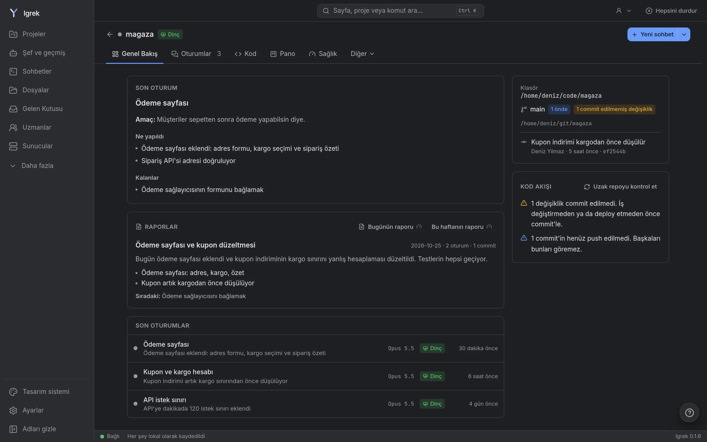

<p align="center"></p>

<h1 align="center">Igrek</h1>

<p align="center">
  Claude Code ve Codex işlerinin hepsi için tek pencere.<br>
  AI'ın neyi neden değiştirdiğini gör, özel bilgilerini ondan koru.
</p>

<p align="center"><strong>İndirmek için tıkla:</strong></p>

<p align="center">
  <a href="https://github.com/Mohamedattiadev/igrek/releases/download/v0.1.22/Igrek_0.1.22_x64_en-US.msi"></a>
  <a href="https://github.com/Mohamedattiadev/igrek/releases/download/v0.1.22/Igrek_0.1.22_aarch64.dmg"></a>
  <a href="https://github.com/Mohamedattiadev/igrek/releases/download/v0.1.22/Igrek_0.1.22_x64.dmg"></a>
  <a href="https://github.com/Mohamedattiadev/igrek/releases/download/v0.1.22/Igrek_0.1.22_amd64.AppImage"></a>
  <a href="https://github.com/Mohamedattiadev/igrek/releases/download/v0.1.22/Igrek_0.1.22_amd64.deb"></a>
</p>

<p align="center">
  Ücretsiz. Hesap yok. API anahtarı yok.<br>
  <a href="https://mohamedattiadev.github.io/igrek/tr/">Site</a> ·
  <a href="https://mohamedattiadev.github.io/igrek/tr/docs/">Belgeler</a> ·
  <a href="README.md">English</a>
</p>

<p align="center"></p>

## 3 adımda başla

1. Yukarıdaki düğmeyle **indir** ve dosyayı aç.
2. Bilgisayarın sorarsa **izin ver** (aşağıya bak). Bu bir kez olur.
3. **Uygulamayı takip et.** Dilini ve proje klasörlerini seç. Claude Code ya da Codex yoksa Igrek kurmayı önerir.

Mac'in hangisi bilmiyor musun? Apple menüsünden Bu Mac Hakkında'yı aç. M1, M2 ya da üstü yazıyorsa Apple silicon'ı,
yazmıyorsa Intel'i seç.

<details>
<summary><strong>Bilgisayarın uygulama güvenli değil mi diyor?</strong></summary>

Igrek'in ücretli imza sertifikası yok, bu yüzden sistem bir kez sorar.

- **Windows:** **Ek bilgi**'ye, sonra **Yine de çalıştır**'a tıkla.
- **macOS:** Mesajı kapat, **Sistem Ayarları > Gizlilik ve Güvenlik**'i aç, aşağı kaydır, **Yine de Aç**'a tıkla.
- **Linux AppImage:** `chmod +x Igrek_*.AppImage` çalıştır, sonra aç. Bazı sistemlerde önce `libfuse2` gerekir.

</details>

## Tek komutla kurmak ister misin?

Terminale tek satır yapıştır. Igrek'i kurar ya da son sürüme günceller.

**Linux ve macOS**

```bash
curl -fsSL https://raw.githubusercontent.com/Mohamedattiadev/igrek/main/scripts/install.sh | sh
```

**Windows** (PowerShell, [Git for Windows](https://git-scm.com/download/win) kurulu olmalı)

```powershell
irm https://raw.githubusercontent.com/Mohamedattiadev/igrek/main/scripts/install.ps1 | iex
```

Sonra `igrek` yaz ve http://localhost:7777 adresini aç. [Claude Code](https://docs.claude.com/en/docs/claude-code) da gerekir.

## Sana ne sağlar

- **Dosyanın neden değiştiğini gösterir.** Değişen her dosyada, arkasındaki mesajı gösteren bir Neden? düğmesi var.
- **Projeler arasında çalışır.** Bir iş yaz, Igrek onu doğru projeye göndersin.
- **Projeni kontrol eder.** Güvenlik, testler ve daha fazlası puanlanır, basit sorunlarda Düzelt düğmesi çıkar.
- **Özel bilgilerini korur.** IBAN, kart numarası ve `.env` değerleri mesaj bilgisayarından çıkmadan gizlenir.
- **Geri almanı sağlar.** AI'ın değiştirdiği her dosya tek tıkla geri alınır.
- **Kod bilmeyenler için de uygundur.** Basit mod sade dille konuşur, sen yalnızca ne istediğini yazarsın.

Her şey senin bilgisayarında çalışır. Telemetri ve Igrek sunucusu yok. Igrek zaten olan Claude Code ve Codex
girişlerini kullanır. Bütün özellikler: [belgeler](https://mohamedattiadev.github.io/igrek/tr/docs/).

## Sorular

**Verilerim nerede?** Bilgisayarında, `~/.igrek` içinde.

**Nasıl güncellerim?** Yeni sürüm çıkınca uygulama sorar. Komutla kurduysan komutu yeniden çalıştır.

**Nasıl kaldırırım?** Uygulamayı kaldır, sonra `~/.igrek` (verin) ve `~/.local/share/igrek-runtime` klasörlerini sil
(Windows: `%LOCALAPPDATA%\igrek-runtime`).

**Yardım mı lazım?** [SUPPORT.md](SUPPORT.md) dosyasına bak. Güvenlik sorunları: [SECURITY.md](SECURITY.md).

## Lisans

Şirketler dahil herkes ücretsiz kurup kullanabilir. Igrek açık kaynak değildir: [LICENSE](LICENSE) dosyasına bak.
