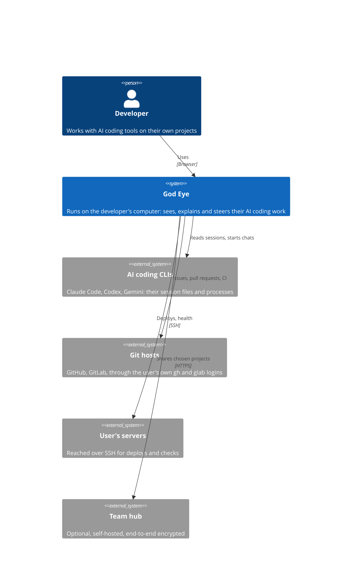
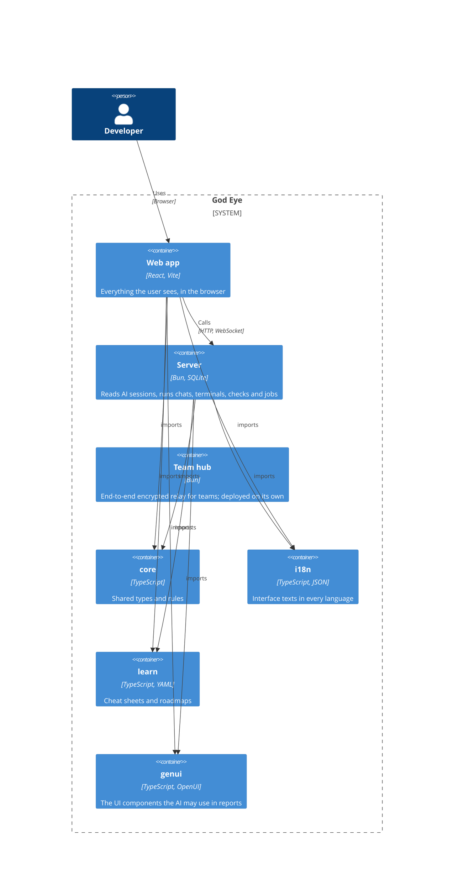
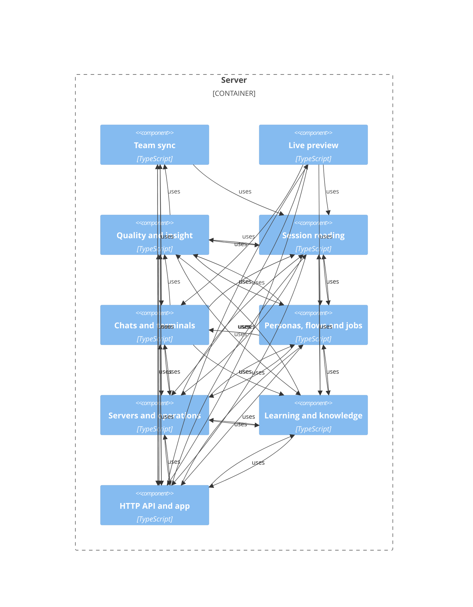

# God Eye architecture (C4)

<!-- Written by `bun scripts/c4.ts` from the code; do not edit by hand. A test fails when it is out of date. -->

Three of the four C4 levels (Simon Brown, c4model.com). The fourth, code, is the source itself. The rules these
pictures must keep are in `scripts/arch-check.ts` (`bun run lint:arch`).

## 1. Context

## 2. Containers

## 3. Components of the server

Server modules grouped by area (matched on file names in `scripts/c4.ts`); an arrow means one area imports the other.

